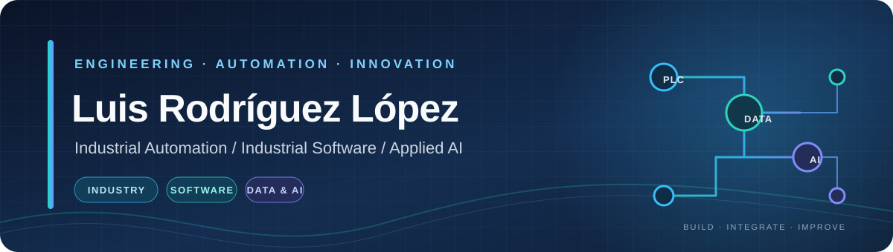

  

  
  
  

  <b>Conecto automatización industrial, desarrollo de software y análisis de datos para construir soluciones útiles en entornos reales.</b>

---

## 👋 Sobre mí

Soy ingeniero en **Electrónica Industrial y Automática** por la Universidade de Vigo y cuento con formación de posgrado en **Data Science e Inteligencia Artificial**.

Mi trabajo se mueve entre la industria y el software: desde sistemas PLC y SCADA hasta aplicaciones web, arquitecturas de datos y herramientas basadas en inteligencia artificial. Me interesa especialmente convertir procesos complejos y datos operativos en sistemas claros, integrables y mantenibles.

## 🧭 Áreas de especialización

<table>
  <tr>
    <td width="33%" valign="top">
      <h3>⚙️ Automatización</h3>
      <ul>
        <li>PLC y sistemas SCADA</li>
        <li>Siemens WinCC</li>
        <li>TIA Portal</li>
        <li>Integración industrial</li>
      </ul>
    </td>
    <td width="33%" valign="top">
      <h3>💻 Software</h3>
      <ul>
        <li>Aplicaciones web y escritorio</li>
        <li>APIs y servicios</li>
        <li>Dashboards operativos</li>
        <li>Docker e infraestructura</li>
      </ul>
    </td>
    <td width="33%" valign="top">
      <h3>🧠 Datos e IA</h3>
      <ul>
        <li>ETL y series temporales</li>
        <li>Machine Learning</li>
        <li>Modelos predictivos y XAI</li>
        <li>Aplicaciones con LLM</li>
      </ul>
    </td>
  </tr>
</table>

## 🚀 Proyectos destacados

<table>
  <tr>
    <td width="50%" valign="top">
      
      <h3>⚡ GeSCADA</h3>
      
<b>Suite de ingeniería para Siemens WinCC.</b> Herramientas para organizar datos exportados desde TIA Portal, revisar Tags, comparar revisiones y reutilizar configuraciones y recursos de ingeniería.

      

        <a href="https://luisrodriguezlopez96.github.io/GeSCADA_Public/">🌐 Landing page</a> ·
        <a href="https://github.com/luisrodriguezlopez96/GeSCADA_Public">Código y presentación</a>
      

      
 

    </td>
    <td width="50%" valign="top">
      
      <h3>🍇 Gestión Vitícola</h3>
      
<b>Gestión de explotación desde escritorio y móvil.</b> Aplicación de escritorio y PWA para parcelas, tareas, tratamientos y vendimia, con trabajo de campo sin conexión y sincronización posterior.

      

        <a href="https://luisrodriguezlopez96.github.io/Vineyard_Public/">🌐 Landing page</a> ·
        <a href="https://github.com/luisrodriguezlopez96/Vineyard_Public">Presentación del proyecto</a>
      

      
  

    </td>
  </tr>
  <tr>
    <td width="50%" valign="top">
      
      <h3>🧠 MybrAIn</h3>
      
<b>Eficiencia energética en refrigeración industrial.</b> Plataforma modular orientada a monitorización, análisis energético y optimización de instalaciones frigoríficas, con integración en sistemas industriales.

      

        <a href="https://mybrain.es/">🌐 Web del producto</a> ·
        <a href="https://github.com/luisrodriguezlopez96/MybrAIn_Public">Repositorio público de referencia</a>
      

      
 

    </td>
    <td width="50%" valign="top">
      
      <h3>📊 InvestBot-AI</h3>
      
<b>Investigación en análisis y optimización de carteras.</b> Proyecto que combina optimización Markowitz, predicción con XGBoost, explicabilidad SHAP, backtesting y dashboard interactivo.

      
<a href="https://github.com/luisrodriguezlopez96/InvestBot-AI-public">Ver proyecto y resultados</a>

      
  

    </td>
  </tr>
</table>

## 🧰 Tecnologías y herramientas

  
  
  
  
  
  
  
  
  
  
  
  
  

## 🎓 Formación

- **Ingeniería Electrónica Industrial y Automática** — Universidade de Vigo.
- **Máster en Data Science e Inteligencia Artificial.**

## 🔭 Cómo trabajo

Me centro en construir soluciones que puedan utilizarse y mantenerse: arquitecturas modulares, integraciones fiables, datos trazables, pruebas y documentación. Distingo entre funcionalidades validadas y líneas experimentales, especialmente cuando el software se conecta a procesos industriales reales.

---

  <h3>¿Hablamos de automatización, software industrial o IA aplicada?</h3>
  
    
  Diseñar · Integrar · Automatizar · Mejorar

